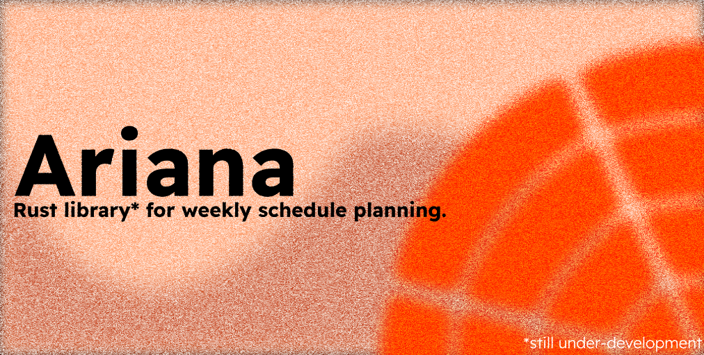

# Ariana

Ariana Engine is a Rust library for weekly schedule planning. It provides the basic building blocks for representing planned activities, recurring weekly events, weekdays, and time slots.

The engine can identify free time around existing events, detect conflicts, and distribute activities across the least busy days of the week. Its main domain types are:

- `EventToSchedule`, which describes an activity to schedule (weekly duration, min/max session durations);
- `WeekEvent`, which describes an event already occupying part of a typical week;
- `Day`, which represents a weekday with its scheduled events;
- `DayName`, an enum representing the days of the week;
- `Timeslot`, which represents a time interval in milliseconds from midnight.

## Status & Disclaimer

> [!WARNING]
> This project is in **active development and experimental**. While the core scheduling logic is operational, the API and algorithms are subject to breaking changes, hardening, and optimizations. It should not yet be relied upon for production scheduling.

## Features

- **Free slot discovery**: automatically detects free slots in a day with existing events.
- **Fair distribution**: balances scheduled events across days with the lowest workload.
- **Session constraints**: respects min and max duration bounds per session.

## Development

Run the test suite with:

```bash
cargo test
```

Check compilation with:

```bash
cargo check
```

The current tests cover empty days, consecutive events, overlapping events, events ending at midnight, and full-day events.
